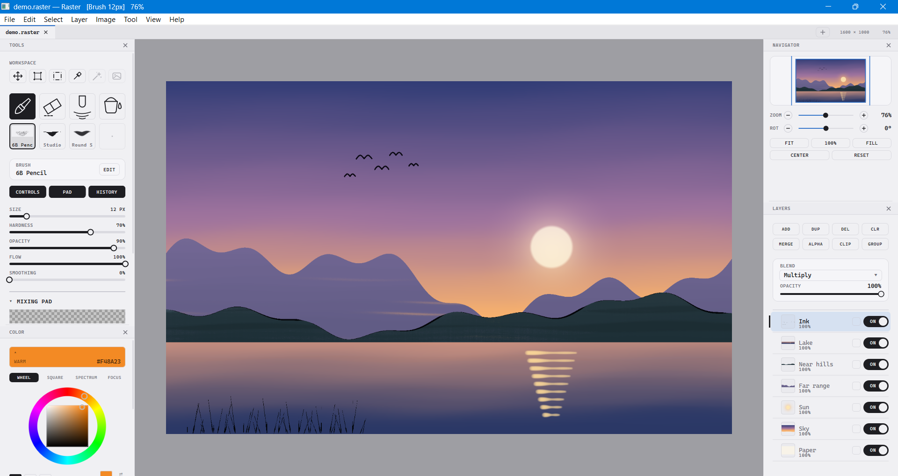
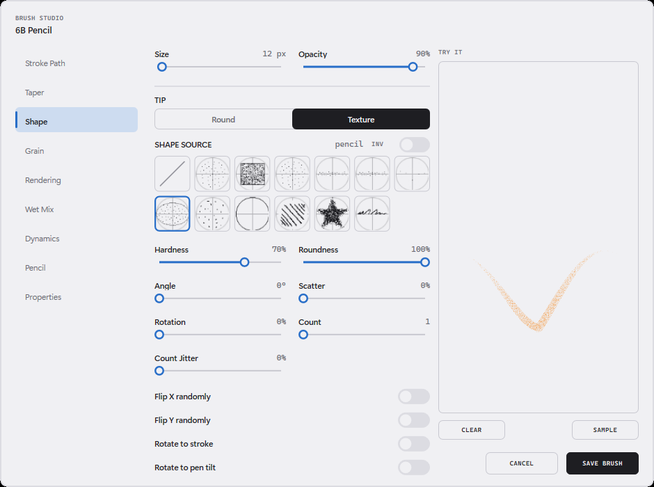
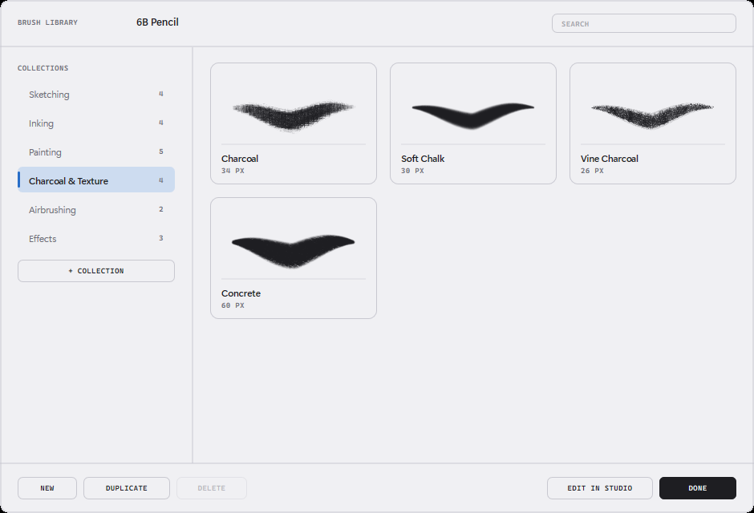
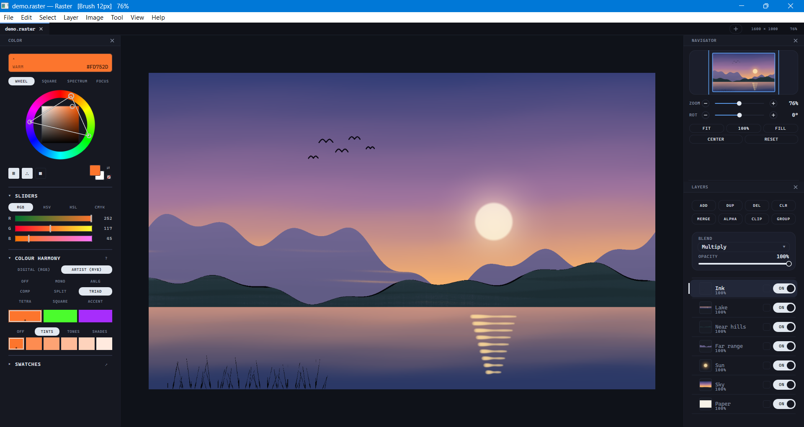
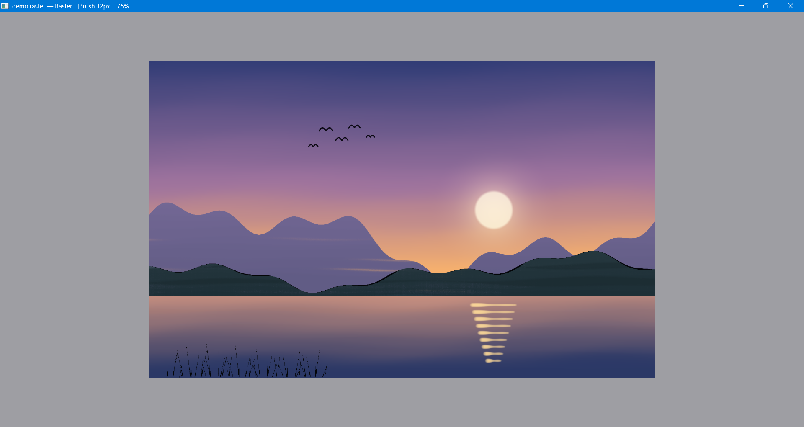
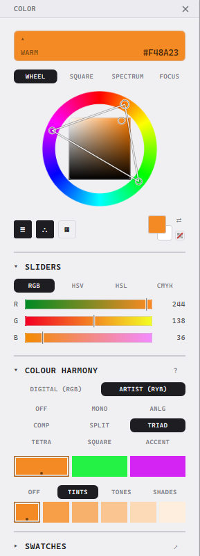

# Raster

**A native Windows painting application, written from scratch in C++20 and Direct3D 11.**
Built for pen tablets: a brush engine that keeps up with
the pen, 16-bit colour throughout, real CMYK, and an interface that stays out of the way.

> **About this repository.** Raster itself is closed source. This is a showcase: screenshots,
> an overview of the design, and a selection of real source files from the project in
> [`samples/`](samples). The full source is available to recruiters and hiring teams on request.



<sub>The painting in these screenshots was made by the app's own brush engine from scripted
strokes, using the shipped brush presets: the same dabs, tip textures, grain, glazing and
taper a hand on a tablet would get.</sub>

---

## Highlights

**Brush engine**
- 22 built-in brushes in six collections (sketching, inking, painting, charcoal and texture, airbrushing, effects), plus your own.
- A **Brush Studio** with nine categories of settings: stroke path, taper, shape, grain, rendering, wet mix, dynamics, pen and properties. A live scratch pad shows each change as you make it.
- Textured tips and paper grain, elliptical and rotated stamps, scatter, multi-stamp, size and opacity jitter, random flips.
- Pressure curves edited as cubic Béziers, plus tilt and stroke-speed dynamics.
- Wet mixing that picks up and drags the paint underneath, wet edges, glazed and build-up rendering, and per-brush blend modes.
- Tapered strokes that **don't lag the pen**: dabs land under the nib immediately, and the tail is re-rendered once the stroke's real end is known.

**Rendering and latency**
- Strokes accumulate in a **GPU stroke buffer** and fold into the layer once, on pen-up. Shapes, textures, grain, scatter and taper are all drawn on the GPU.
- Brushes that must read the canvas (wet mixing, blend modes, smudge, alpha lock) fall back to a **multithreaded CPU renderer**. It splits each batch of dabs into row bands, so the result is bit-identical to a single thread.
- A waitable swapchain at frame latency 1, with frames drawn from the main loop and never from input handlers, so reading the pen is never blocked behind a `Present`.
- Every composite pass is scissored to the visible part of the canvas, so zooming into a large document costs only what is on screen.

**Layers and colour**
- 18 blend modes, groups, clipping masks, alpha lock and opacity.
- **Native Grayscale, RGB and CMYK documents at 16 bits per channel**, not simulated modes. A CMYK brush lays down ink amounts.
- ICC colour management through Little CMS. The canvas is shown through a GPU display transform (a 4-D lattice for CMYK press profiles, an analytic matrix-shaper for RGB).
- A colour panel with wheel, square and spectrum pickers; RGB, HSV, HSL and CMYK sliders; and **colour harmony** on either a digital (RGB) or an artist's (RYB) wheel, with nine schemes and tint, tone and shade strips.
- Swatch libraries: 20 built-in palettes, GIMP `.gpl` import and export, per-document palettes, and palette extraction from any image.

**Workspace**
- Document tabs, dockable and floating panels, zen mode (<kbd>Tab</kbd>) and borderless fullscreen (<kbd>F11</kbd>).
- Navigator with zoom and rotation; zoom, rotate and fit commands ease in instead of jumping.
- Selections: rectangle, ellipse, lasso, polygon and magic wand, with add, subtract and intersect, feather, grow and shrink. Brushes paint through a feathered selection softly.
- A native `.raster` format (layered, compressed), plus import and export of PNG, JPEG, TIFF and BMP, keeping 16 bits where the format can hold them.
- System clipboard and drag and drop in both directions. Drag a layer out of the layer panel and it lands as a PNG.

---

## Screenshots

| | |
|:---:|:---:|
|  |  |
| **Brush Studio:** every setting of a brush, with a live scratch pad | **Brush library:** collections with previews rendered by the real engine |
|  |  |
| **Midnight theme:** one of five themes | **Zen mode:** all chrome hidden, one key away |

<p align="center">
  <br>
  <b>Colour panel:</b> a triad on the artist's RYB wheel, with generated tints
</p>

---

## Code samples

Real files from the project, unedited apart from comment punctuation. They show how the
hard parts are done; they depend on headers that are not included here, so they are for
reading rather than building. [`samples/README.md`](samples/README.md) has a short guide
to each one.

| Sample | What it shows |
|---|---|
| [GPU brush shader](samples/gpu-brush-shader/brush_dab.hlsl) | The HLSL dab: rotated ellipse, tip texture, grain and wet edges, written to match the CPU renderer arithmetic for arithmetic |
| [CPU dab renderer](samples/cpu-dab-renderer) | The CPU fallback, drawn in row bands across cores with results bit-identical to one thread |
| [Undo snapshots](samples/undo-snapshots/StrokeSnapshot.h) | Copy-on-write undo in 128 px tiles, so a stroke pays for the area it covers, not the canvas size |
| [Stroke stabilizer](samples/stroke-stabilizer) | Smoothing that behaves the same at 133 Hz and 1000 Hz, with a hard cap on lag |
| [Retro taper](samples/retro-taper/BrushEngine_RetroTaper.cpp) | Tapered strokes with no pen lag: stamp now, re-render the tail when the stroke ends |
| [Colour harmony](samples/color-harmony) | Colour theory as a painter uses it, including Itten's RYB wheel as a 24-point remap of HSV |
| [Engine tests](samples/tests/brush_engine_checks.cpp) | The checks that pin all of the above, including a pixel-by-pixel GPU vs CPU comparison |

---

## Engineering notes

- **One design, two processors.** The GPU dab shader is the twin of the CPU dab renderer: the same arithmetic in the same order, down to hand-written bilinear texture taps, because hardware filtering keeps only about 8 bits of sub-texel precision. A test draws eight shipped brushes both ways and compares every pixel; they agree to within 25/65535.
- **Undo that costs what the stroke covers.** The pixels a stroke is about to change are copied lazily, in 128 px tiles, one dab before each write. On a 4000×4000 document the obvious approach copies 128 MB at every pen-down.
- **Tapers without lag, and without randomness breaking them.** Replaying a stroke's tail restores each dab's random-number state, so scattered and jittered brushes re-render exactly. A test proves it pixel for pixel against the delay-line approach it replaced.
- **Measured, not guessed.** A built-in benchmark times every shipped brush on both paths. On an i5-11400H with an RTX 3050 Laptop GPU, a 2,600 px stroke costs **5 to 11 ms of CPU in total** on the GPU path, most of it the single read-back at pen-up. The Soft Airbrush cost 109 ms on the earlier CPU-only path.
- **Few dependencies.** The only third-party library is Little CMS. Image codecs come from the Windows Imaging Component, compression from the Windows Compression API, and JSON is a small hand-written parser.

**Size:** about 39,000 lines of C++ and 7 HLSL shaders, with a self-test suite of over
400 checks covering file round-trips, colour conversion, selections and the brush engine.

### Data flow

```
pen / mouse -> stabilizer -> BrushEngine -+-> StrokeBuffer (GPU, RGBA16 premultiplied) -+
                                          +-> DabRenderer  (CPU, banded across cores)   |
                                                                                         v
       swapchain <- canvas blit <- Compositor (18 blend modes) <- PixelBuffer (16-bit, per layer)
```

### Stack

C++20, Win32, Direct3D 11 and HLSL, DXGI flip-model swapchain, Windows Ink (`WM_POINTER`)
for pressure and tilt, Little CMS for ICC, WIC for image codecs, CMake and vcpkg.


